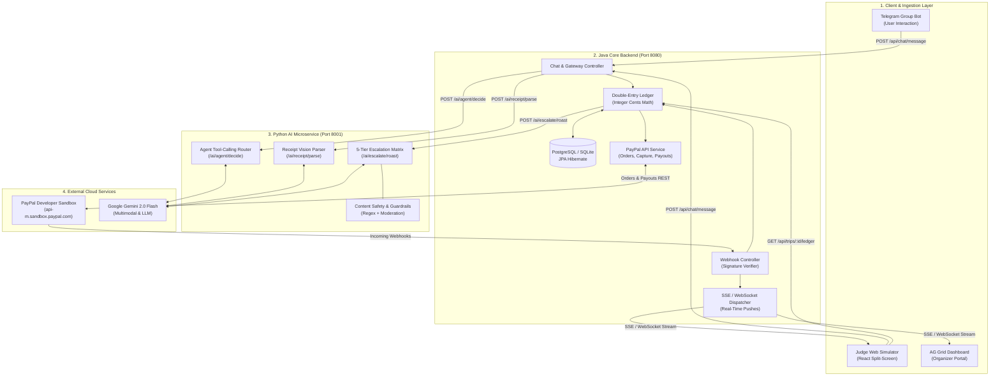

# TripSheriff AI — Cross-Task Team Collaboration & Interface Guide
## Architecture, Inter-Task Contracts, and Role Execution Plans
### PayPal AI Hackathon 2026 | Target Deadline: Nov 12, 2026

---

## 1. Executive Overview & System Topology

To maximize performance, commercial fintech credibility, and development velocity, the team is splitting the architecture into a **clean hybrid model**:

1. **Java Core Backend (Spring Boot / Micronaut, Port `8080`):** Owns the relational database, double-entry financial ledger (integer cents), PayPal Orders and Batch Payouts lifecycle, real-time webhook ingestion, and state management.
2. **Python AI Microservice (FastAPI / `google-genai`, Port `8001`):** Owns multimodal receipt OCR (Gemini 2.0 Flash Vision), the agentic natural-language tool-calling loop, the 5-tier escalation personality engine, and dynamic meme card generation (Pillow).
3. **Client Gateways & Web Simulator:** Telegram bot webhook/polling gateway and the split-screen **Hosted Judge Web Simulator** (React + AG Grid) enabling instant browser-based evaluation.



---

## 2. Role Breakdown & Section Ownership

Every task from the [Master Implementation Plan](IMPLEMENTATION_PLAN.md) is mapped to a primary owner.

| Role | Primary Tasks | Tech Stack | Key Deliverable |
|---|---|---|---|
| **Python AI Engineer** | **Task F** (Agentic Tool-Loop & Roast Matrix)<br>**Task G** (Multimodal Receipt OCR)<br>**Task M** (Safety Guardrails) | Python 3.11+, FastAPI, `google-genai` SDK, Pillow, Pydantic | High-speed AI microservice running on `localhost:8001` with 3 core REST endpoints. |
| **Java Backend & Payments Engineer** | **Task B** (Double-Entry Ledger & Debt Graph)<br>**Task C** (PayPal Orders & Capture Flow)<br>**Task D** (PayPal Batch Payouts API)<br>**Task E** (Webhook Verification & Ingestion) | Java 21+, Spring Boot 3, Spring Data JPA, HttpClient, Jackson | Core business service on `localhost:8080` orchestrating database state, calling Python AI, and handling PayPal Sandbox rails. |
| **Gateway & Frontend Engineer** | **Task A** (Telegram Bot Gateway & Web Simulator)<br>**Task I** (AG Grid Organizer Dashboard) | TypeScript, React, Tailwind CSS, AG Grid Community, `python-telegram-bot` (or Java Telegram client) | Responsive web interface for judges + live Telegram group gateway. |
| **DevOps & Demo Lead** | **Task K** (Render Cloud Infra & Keep-Alive)<br>**Task L** (3-Minute Video Storyboard & Rehearsal) | Docker, Render Blueprints, Screen Recording, Devpost Documentation | Live cloud URL with zero cold-start drops, plus the winning 3-minute video submission. |

---

## 3. The Inter-Task REST Contracts (The Binding Glue)

To allow the Java and Python engineers to code immediately without blocking each other, these HTTP/JSON contracts are **frozen**.

---

### Contract 1: Java Backend $\rightarrow$ Python AI Microservice

The Python service runs on port `8001`. The Java backend calls these three endpoints:

#### Endpoint 1.1: Intent Parsing & Tool-Calling (`POST /ai/agent/decide`)
Called by Java when a user sends unstructured natural language in chat (e.g. *"Paid $120 for groceries, split with Dave and Alex"*).

* **Java Request:**
```json
{
  "trip_id": "trip_bali_2026",
  "sender_id": "user_01",
  "sender_name": "Sarah",
  "message_text": "Paid $120 for seafood dinner split with @alex_travels and @dave_k",
  "active_members": [
    {"user_id": "user_01", "name": "Sarah", "handle": "@sarah_c"},
    {"user_id": "user_02", "name": "Alex", "handle": "@alex_travels"},
    {"user_id": "user_03", "name": "Dave", "handle": "@dave_k"}
  ]
}
```

* **Python Response:**
```json
{
  "action": "LOG_EXPENSE",
  "confidence": 0.98,
  "parsed_data": {
    "description": "Seafood dinner",
    "amount_cents": 12000,
    "currency": "USD",
    "payer_id": "user_01",
    "split_type": "EQUAL",
    "split_with_user_ids": ["user_01", "user_02", "user_03"]
  },
  "reply_text": "🍽️ Logged **$120.00 Seafood dinner** paid by Sarah. Splitting 3 ways ($40.00 each)."
}
```

* *Fallback Actions:* `"CHECK_BALANCES"`, `"DISPUTE_OR_PAUSE"`, `"GENERAL_CHAT"`.

---

#### Endpoint 1.2: Multimodal Receipt OCR (`POST /ai/receipt/parse`)
Called by Java when a user uploads a photo of a receipt. Java passes the image bytes or base64 string.

* **Java Request:**
```json
{
  "trip_id": "trip_bali_2026",
  "image_base64": "data:image/jpeg;base64,/9j/4AAQSkZJRgABAQ...",
  "currency": "USD"
}
```

* **Python Response:**
```json
{
  "status": "SUCCESS",
  "merchant": "Sunset Beach Bistro",
  "date": "2026-10-26",
  "subtotal_cents": 12000,
  "tax_cents": 1200,
  "tip_cents": 2400,
  "total_cents": 15600,
  "items": [
    {"name": "Grilled Red Snapper", "qty": 1, "price_cents": 4500},
    {"name": "Truffle Fries", "qty": 2, "price_cents": 2500},
    {"name": "Tropical Cocktails", "qty": 3, "price_cents": 5000}
  ],
  "suggested_reply": "🧾 Extracted receipt from **Sunset Beach Bistro** ($156.00). Tap items below to claim what you ordered!"
}
```

---

#### Endpoint 1.3: Escalation & Roast Generator (`POST /ai/escalate/roast`)
Called by Java when a scheduled sweep or `/sim_time` command detects an overdue debt.

* **Java Request:**
```json
{
  "trip_id": "trip_bali_2026",
  "debtor_id": "user_02",
  "debtor_name": "Alex",
  "debtor_handle": "@alex_travels",
  "creditor_name": "Sarah",
  "amount_cents": 8000,
  "currency": "USD",
  "expense_description": "Sunset Villa Deposit",
  "hours_overdue": 36,
  "tier": "DISAPPOINTED_PARENT",
  "roast_consent": "SPICY",
  "paypal_checkout_url": "https://www.sandbox.paypal.com/checkoutnow?token=5O190127TN364715T"
}
```

* **Python Response:**
```json
{
  "tier": "DISAPPOINTED_PARENT",
  "generated_text": "Alex beta, I see the photos you posted from the rooftop lounge two hours ago. Very glamorous. But Sarah is still waiting on your $80.00 villa share from yesterday. Is this how we raised you? To sip craft mezcal while your friend fronts your roof?",
  "image_card_base64": null,
  "call_to_action_buttons": [
    {"text": "💳 Pay $80.00 via PayPal", "url": "https://www.sandbox.paypal.com/checkoutnow?token=5O190127TN364715T"}
  ]
}
```
*(Note: If `tier == "PUBLIC_ROAST"`, Python also returns `image_card_base64` containing the generated Pillow "WANTED: DEADBEAT" card).*

---

### Contract 2: Gateways (Telegram / Web Simulator) $\rightarrow$ Java Backend

The Java backend listens on port `8080`:

* **`POST /api/chat/message`**:
  Receives all incoming user chatter, forwards text/images to Python AI, executes ledger math, and returns the formatted response with PayPal buttons.
* **`GET /api/trips/{tripId}/ledger`**:
  Returns current integer-cent balances, member list, and active debts for the AG Grid dashboard.
* **`POST /api/trips/{tripId}/payout/confirm`**:
  Organizer clicks to authorize the PayPal Batch Payout. Java executes `POST /v1/payments/payouts` with an idempotency key.
* **`POST /api/trips/{tripId}/sim-time`**:
  Fast-forward time simulator (`{"hours_to_advance": 24}`) allowing judges to trigger escalation tiers in seconds.

---

### Contract 3: Real-Time PayPal Webhooks $\rightarrow$ Java Backend

* **`POST /api/paypal/webhook`**:
  - Validates `PayPal-Transmission-Sig` via PayPal's `/v1/notifications/verify-webhook-signature`.
  - For `PAYMENT.CAPTURE.COMPLETED`: Decodes `custom_id` (`tripId|debtorId|expenseId`), sets split status to `SETTLED`, updates ledger, and broadcasts via SSE to Web Simulator / Telegram:
    `"🎉 HALLELUJAH! Alex has settled $80.00 for Villa Deposit via PayPal!"`

---

## 4. Specific Execution Plan by Role

### 🐍 Section Plan: Python AI Engineer

Your mission is to provide the intelligence, multimodal vision, and comedic personality matrix.

1. **Project Directory:** Create a clean microservice folder at `ai-service/`.
2. **Dependencies (`requirements.txt`):**
   ```txt
   fastapi>=0.110.0
   uvicorn>=0.28.0
   pydantic>=2.6.0
   google-genai>=0.1.1
   pillow>=10.2.0
   python-dotenv>=1.0.0
   ```
3. **Core Files to Implement:**
   - `ai-service/app/main.py`: FastAPI server exposing the 3 contracts above.
   - `ai-service/app/services/receipt_vision.py`: Gemini 2.0 Flash Vision client parsing receipt images with strict Pydantic JSON schemas.
   - `ai-service/app/services/personality_matrix.py`: 5 prompt templates calibrated for each tier (Polite, Passive-Aggressive, Disappointed Parent, Roast, Embargo).
   - `ai-service/app/services/roast_card.py`: Pillow-based dynamic image generator rendering a "WANTED: Deadbeat" poster with name and amount.
   - `ai-service/app/services/moderation.py`: Regex & prompt safety filter preventing profanity, hate speech, or real harassment.
4. **Mock Mode for Instant Java Teammate Support:**
   Add a flag `USE_MOCK_AI=true` in `ai-service/.env` that returns canned JSON immediately. This allows your Java teammate to integrate endpoints within 10 minutes of Day 1.

---

### ☕ Section Plan: Java Backend Engineer

Your mission is to build the financial fortress, database persistence, and PayPal API lifecycle.

1. **Project Directory:** Create the Java service at `backend/` using Spring Boot 3 + Java 21.
2. **Key Dependencies (`pom.xml` / `build.gradle`):**
   - `spring-boot-starter-web`
   - `spring-boot-starter-data-jpa`
   - `postgresql` (or `sqlite-jdbc` for local dev)
   - `jackson-databind`
3. **Core Modules to Implement:**
   - **Data Models:** `Trip`, `TripMember`, `Expense`, `ExpenseSplit` (all amounts in `long amountCents`).
   - **`LedgerEngine.java`:**
     - Split math distributing remaining cents deterministically.
     - **Bipartite Minimum Cash Flow algorithm:** Simplifies circular debts into minimal transactions.
   - **`PayPalClient.java`:**
     - OAuth2 Client Credentials token caching with 8-hour refresh.
     - `createOrder(amountCents, currency, customId)` using `experience_context`.
     - `captureOrder(orderId)` called on redirect `/api/payment/success`.
     - `executeBatchPayout(List<PayoutItem> items, String idempotencyKey)`.
   - **`AiServiceClient.java`:**
     - Simple HTTP client calling `http://localhost:8001/ai/...` with 3-second timeouts and fallback handling.
   - **`WebhookController.java`:**
     - Signature verification against PayPal Sandbox.
     - Closed-loop event dispatcher.

---

### 💻 Section Plan: Gateway & Frontend Engineer

Your mission is to build the two faces of the product: the chat experience and the judge evaluation portal.

1. **Hosted Judge Web Simulator (Priority 1):**
   - Built with React / Vite in `frontend/`.
   - **Split Screen Layout:**
     - **Left Pane (Live Chat Simulator):** Interactive chat window showing messages from Sarah, Alex, and TripSheriff AI. Buttons for judges: `[Send Sample Receipt]`, `[Simulate Time +24h]`, `[Pay via PayPal Sandbox]`.
     - **Right Pane (AG Grid Dashboard):** Real-time AG Grid table listing expenses, categories, individual debts, and color-coded status badges (`SETTLED`, `PENDING`, `ESCALATED`).
   - Listens to Java's Server-Sent Events (`/api/trips/{id}/stream`) to animate table rows the second a payment clears.
2. **Telegram Bot Gateway (Priority 2):**
   - Python or Java bot client.
   - Configured in `@BotFather` with `/setprivacy -> Disable`.
   - Renders messages and inline URL buttons linking directly to PayPal checkout.

---

### 🚢 Section Plan: DevOps & Demo Lead

Your mission is to ensure the project runs reliably in the cloud and delivers an unbeatable 3-minute video.

1. **Cloud Deployment (Render):**
   - Setup `render.yaml` orchestration.
   - Configure a paid starter instance OR an automated 9-minute keep-alive ping against `/api/health` so PayPal webhooks are never dropped due to free-tier sleep.
2. **Demo Script & Video Storyboard Execution:**
   - Execute the 3-minute video storyboard from Section 4 of the [Implementation Plan](IMPLEMENTATION_PLAN.md).
   - Ensure zero copyrighted music, zero third-party trademark logos in the thumbnail, and strict sub-3:00 runtime.

---

## 5. Parallel Development Strategy (Zero-Blocker Roadmap)

To eliminate dependency bottlenecks, team members should follow this day-by-day synchronization schedule:

```
┌────────────────────────────────────────────────────────────────────────┐
│ DAY 1: Contract Freeze & Mock Day                                      │
│ • Python Engineer creates ai-service with mock JSON endpoints.         │
│ • Java Engineer creates Spring Boot shell calling Python mock URLs.    │
│ • Frontend Engineer mocks the split-screen UI with dummy state.        │
│ ➔ Checkpoint: Java calls Python and gets dummy JSON back in <100ms.    │
├────────────────────────────────────────────────────────────────────────┤
│ DAYS 2–5: Deep Implementation                                          │
│ • Python: Hook up Gemini 2.0 Flash Vision & 5-tier escalation prompts. │
│ • Java: Build integer-cent ledger math & PayPal Orders API + Capture.  │
│ • Gateway: Implement Telegram bot handlers & AG Grid UI components.    │
│ ➔ Checkpoint: End-to-end receipt upload to PayPal payment link.        │
├────────────────────────────────────────────────────────────────────────┤
│ DAYS 6–9: The Closed Loop (Webhooks & Payouts)                         │
│ • Java: Implement Webhook signature verifier + Batch Payouts API.      │
│ • Python: Implement dynamic Pillow meme card generator (Tier 4 Roast).│
│ • Gateway: Connect AG Grid to Java SSE stream for live green flashes.  │
│ ➔ Checkpoint: Paying in PayPal Sandbox instantly updates chat & grid.  │
├────────────────────────────────────────────────────────────────────────┤
│ DAYS 10–13: Cloud Deployment & Judge Simulator Polish                  │
│ • Deploy Java, Python, and DB to Render with keep-alive worker.        │
│ • Verify public HTTPS PayPal webhooks on Render.                       │
│ • Polish Web Simulator so judges need 0 setup to test.                 │
├────────────────────────────────────────────────────────────────────────┤
│ DAYS 14–16: Rehearsal, Video Recording & Early Devpost Submission      │
│ • Record 3-minute screen capture following the exact storyboard.       │
│ • Check claims against the Claims Ledger.                              │
│ • Submit to Devpost 24 hours before the Nov 12 deadline.               │
└────────────────────────────────────────────────────────────────────────┘
```

---

## 6. Shared Local Environment Setup

Each developer should set up their local environment as follows:

```bash
# Terminal 1: Python AI Service
cd ai-service
python -m venv venv
source venv/bin/activate  # On Windows: .\venv\Scripts\activate
pip install -r requirements.txt
uvicorn app.main:app --port 8001 --reload

# Terminal 2: Java Core Backend
cd backend
./mvnw spring-boot:run  # Runs on port 8080

# Terminal 3: Frontend / Web Simulator
cd frontend
npm install
npm run dev  # Runs on port 5173
```

All microservices communicate locally over `localhost` without CORS or proxy friction.
